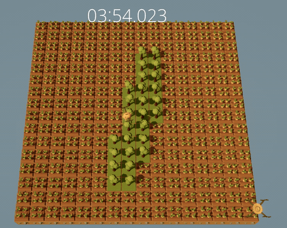

# GANfield: Where Digits Take Root

**A neural network running inside a farming game, growing handwritten digits one field at a time.**

[The Farmer Was Replaced](https://store.steampowered.com/app/2060160/The_Farmer_Was_Replaced/) is a programming game where a drone follows Python-like scripts to work a farm. GANfield gives the drone a new job: generate a handwritten digit on demand, then plant its 16×16 image across the field.



The neural network **actually runs inside the game**. Training happens outside the game, but each digit is generated in the game's scripting environment from a requested label and fresh random noise. The game scripts contain the generator's weights and implement its forward pass, including matrix multiplication, transposed convolution, instance normalization, and activation functions. They do not play back a set of stored digit images, and inference does not require PyTorch.

## Run in the game

Back up your game save before copying files into it. Copy the contents of `farmland/` into the save's script directory, then run `main.py` in the game.

`main.py` generates the digits in `tlist` and plants each result on a 16×16 field. Edit `tlist` in `farmland/main.py` to choose another sequence of digits from 0 to 9. Direct in-game inference can take time because the network operations run in the game script. For a faster demonstration, run `main_sim.py` in the game; it executes `main.py` through the game's simulator with `speedup = 1024`.

## How it works

1. Outside the game, a conditional GAN learns to turn a digit label and random noise into a 16×16 grayscale image. A discriminator checks realism and label agreement, while an auxiliary classifier encourages the generated image to match its requested digit.
2. The exporter converts the trained generator's weights into `farmland/generator_parameters.py`. The discriminator and training code stay outside the game.
3. Inside the game, `farmland/generator.py` and `farmland/ops.py` evaluate the generator using those weights. `main.py` thresholds the output into a 16×16 pattern, and the drone plants that pattern on the field.

## Train and export your own generator

The included game scripts already contain exported weights, so you can run the demo without training a model. To train your own generator, use Python 3.13 with PyTorch and NumPy, then run these commands from this folder:

```sh
python -m cgan_mnist.data
python -m cgan_mnist.train --epochs 50
python -m tools.export_generator_parameters > export.log
```

Training saves a checkpoint in `runs/cnn-conditional-q-projection/`. The exporter writes its generator weights to `farmland/generator_parameters.py`; copy the updated file into the game save to use your newly trained model.

## Project layout

- `farmland/` — in-game generator, tensor operations, exported weights, and planting scripts
- `cgan_mnist/` — MNIST data loader, conditional GAN, training, and sampling
- `tools/` — converter from a PyTorch checkpoint to game-readable weights

## License

GANfield is licensed under the [MIT License](LICENSE).

## References and acknowledgments

- Mirza and Osindero, [*Conditional Generative Adversarial Nets*](https://arxiv.org/abs/1411.1784), 2014 — class-conditioned GANs.
- Miyato and Koyama, [*cGANs with Projection Discriminator*](https://arxiv.org/abs/1802.05637), 2018 — the projection-based class matching design.
- Chen et al., [*InfoGAN: Interpretable Representation Learning by Information Maximizing Generative Adversarial Nets*](https://arxiv.org/abs/1606.03657), 2016 — the auxiliary information objective that inspired `Q(c|x)`.

This project uses the [MNIST handwritten digit dataset](https://yann.lecun.org/exdb/mnist/index.html). Thanks to Yann LeCun, Corinna Cortes, and Christopher J. C. Burges for making it available.

Codex and GPT-6 were used as development tools for implementation, testing,
and documentation.
